# FSDP (Fully Sharded Data Parallel)

---
layout: two-cols-header
---

# About me

::left::

<br>
<br>

- MSU finished (haha)
- разработчик в команде инфраструктуры обучения YandexGPT
- мэйнтейнер YaFSDP (по возможности)

::right::

<br>


---

# Plan

- Collective ops intro
- DDP recap
- Mixed precision recap
- FSDP basics
- Prefetching
- Sharding strategies
- HSDP
- Resharding to a smaller world size
- CPU offloading
- FSDP implementations

---
layout: two-cols-header
---

# Collective ops intro - `torch.distributed`

::left::

- Process groups: 1 GPU - 1 process
- Distributed training requires inter-process communication ops:
  - `AllReduce`
  - `AllGather`
  - `ReduceScatter`
  - ...
- Backends implement these ops: NCCL for GPUs, GLOO for CPUs, etc.

::right::

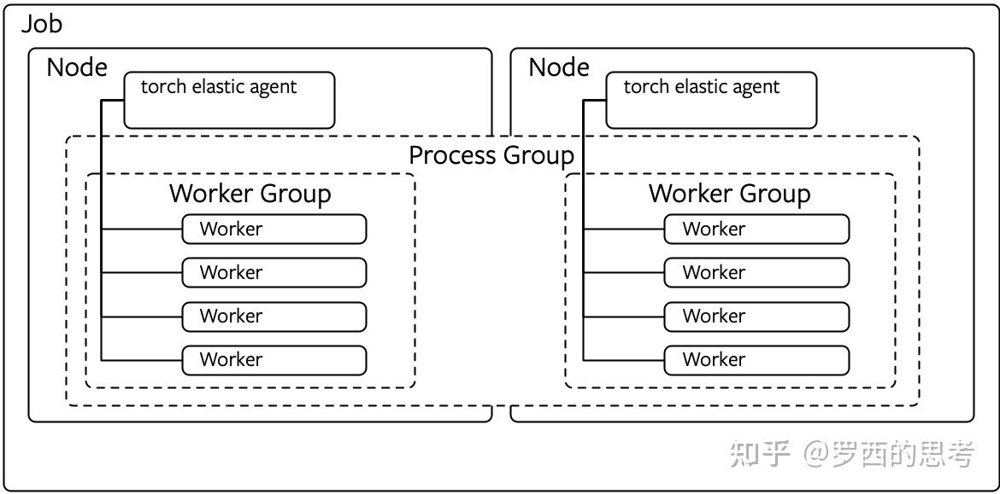

---

# Collective ops intro - `AllReduce`

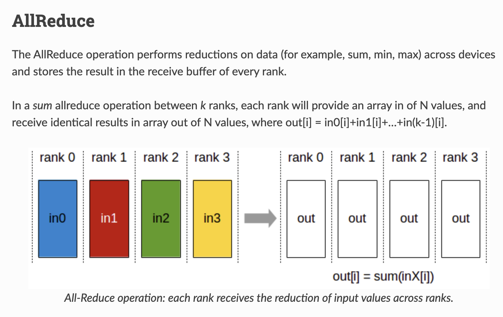

---

# Collective ops intro - `AllGather`

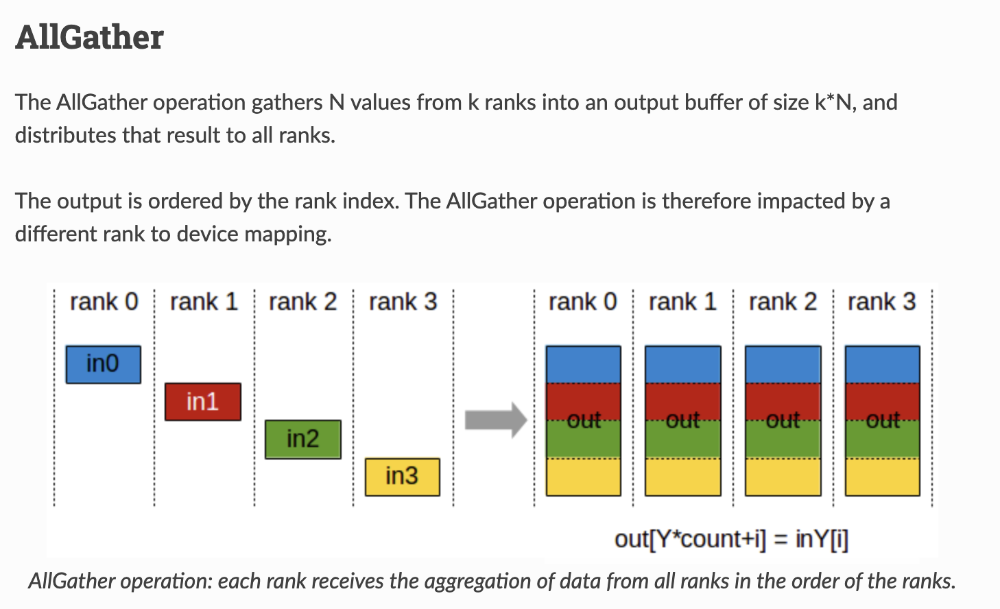

---

# Collective ops intro - `ReduceScatter`

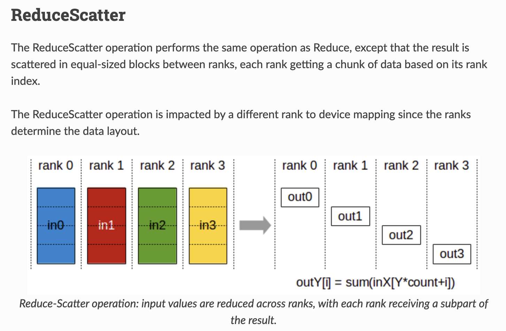

---

# Collective ops intro

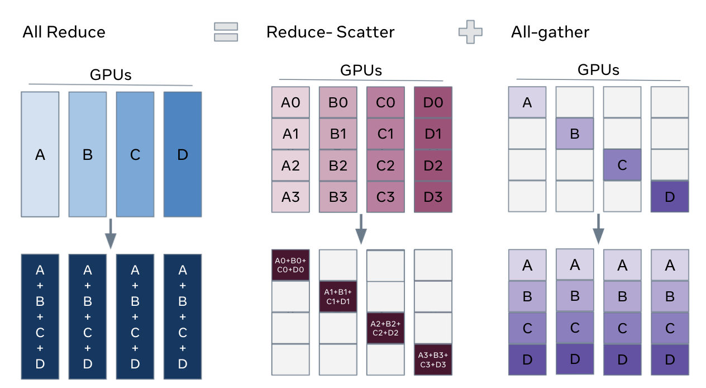

---

# DDP recap

<br>

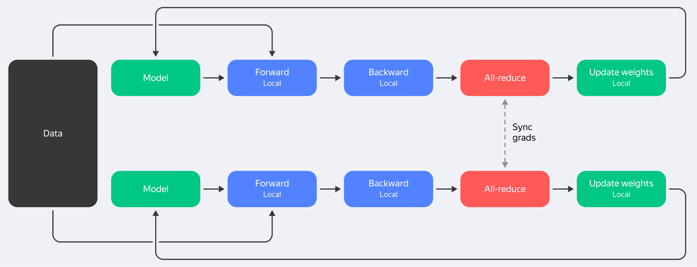

---

# Mixed precision recap

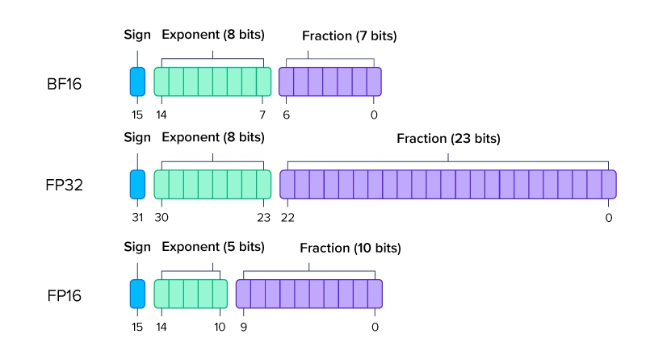

---

# Mixed precision recap

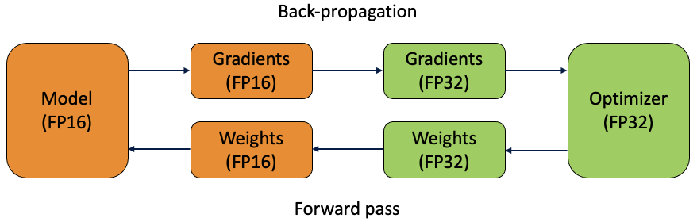

---
layout: section
---

# Fully Sharded Data Parallel

---
layout: two-cols-header
---

# Fully SHARDED Data Parallel

::left::

Huge models don't fit into one GPU.

Lets shard something!

We shard:

- weights
- gradients
- optimizer states

<!-- Compared to DDP:

- master weights, grads and optimizer states are sharded (**less memory overhead**)
- weights are unsharded before forward / backward and resharded after
- grads are reduced (and sharded) after backward
- per-parameter communications are grouped for better network utilization -->

::right::

<br>

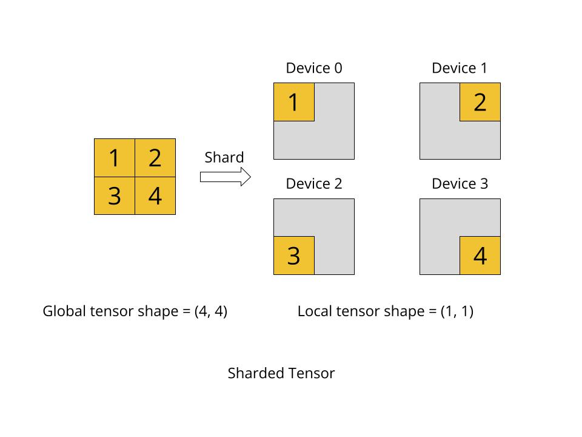

<!--
- каждый ранк отвечает за свой кусочек параметра
-->

---

# FSDP - forward

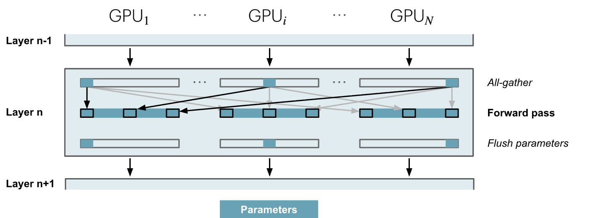

---

# FSDP - backward

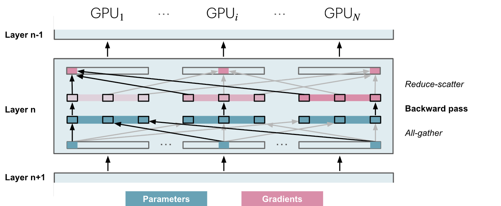

---

# FSDP - overview

<br>
<br>

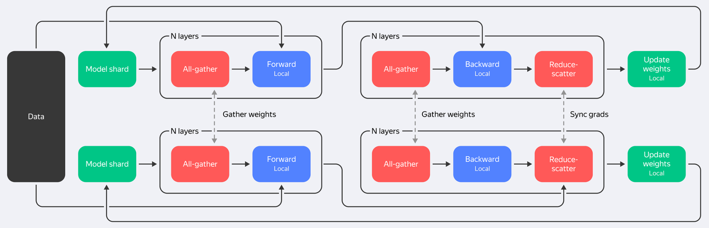

---

# FSDPUnit

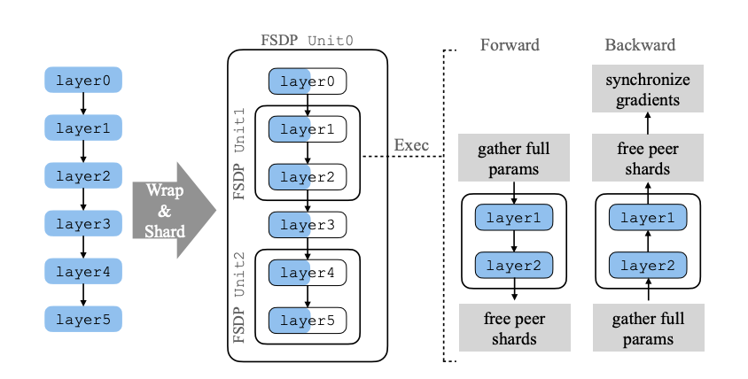

---

# FSDP - memory usage (LLama 70B on 128 GPUs)

Assuming per-transformer-block sharding.

Params per block (80 blocks):

```plain
3 (w1, w2, v1) * 8192 (hidden-size) * 28672 (intermediate-size)
  + (2 (q-proj + out-proj) + 2 * 1/8 (kw-proj)) * 8192 * 8192
  + ...
  ~= 0.85B
```

---

# FSDP - memory usage (LLama 70B on 128 GPUs)

Sharded states (in `fp32`):

```plain
weights = 70B / 128 * 4 bytes ~= 2.2 GB
grads = weights
optim_states = 2 * weights (for AdamW)
```

Unsharded states (in `fp16`/`bf16`):

```plain
weights = 2 * 0.85B * 2 bytes = 3.4 GB
grads = weights
```

Total: `(3.4 GB * 2 + 2.2 GB * (1 + 1 + 2)) = 15.6 GB = 20 % of an 80GB GPU`

Not too bad! (compared to DDP with `4 * 70B * 4 bytes = 1.1TB`)

---

# FSDP - memory usage (LLama 70B on 1024 GPUs)

Sharded states (in `fp32`):

```plain
weights = 70B / 1024 * 4 bytes ~= 0.275 GB
grads = weights
optim_states = 2 * weights (for AdamW)
```

Unsharded states (in `fp16` or`bf16`):

```plain
weights = 2 * 0.85B * 2 bytes = 3.4 GB
grads = weights
```

Total: `(3.4 GB * 2 + 0.275 GB * (1 + 2 + 2)) = 7.9 GB = 10 % of an 80GB GPU`

Great!

---

# FSDP - memory usage

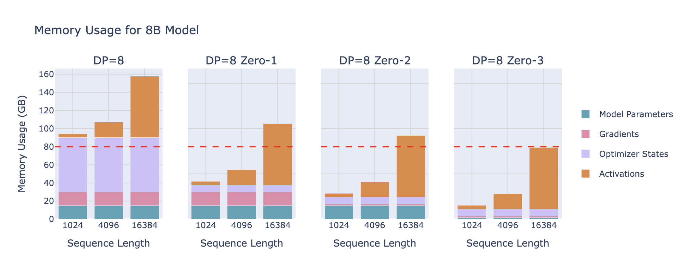

---

# Communication overlap - DDP

<br>
<br>


---

# Communication overlap - FSDP

<br>
<br>


---

# FSDP - communication overhead

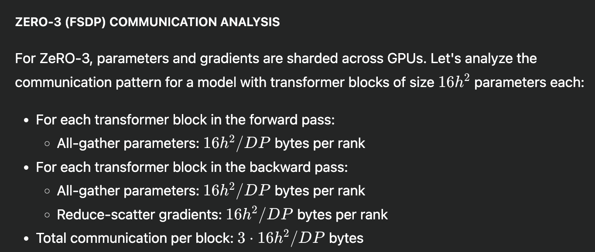
---

# FSDP - communication overhead

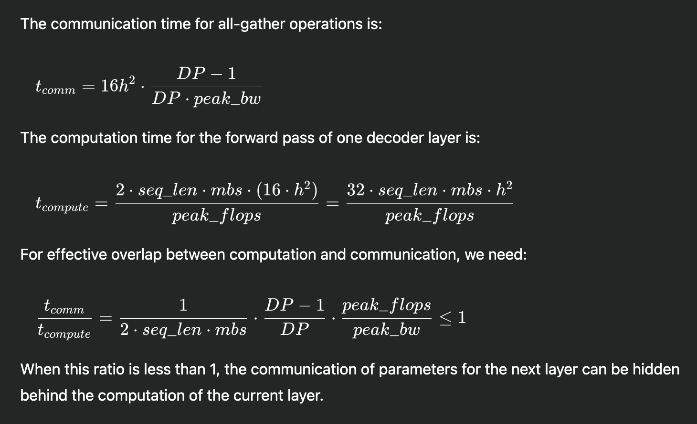

---
layout: section
---

# How to balance memory / comm overhead

---

# Sharding strategies - ZeRO

<br>

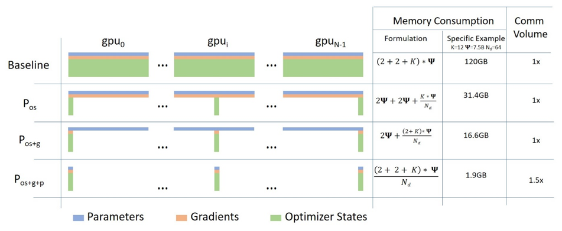

---

# HSDP - Hybrid sharding (motivation)

<br>

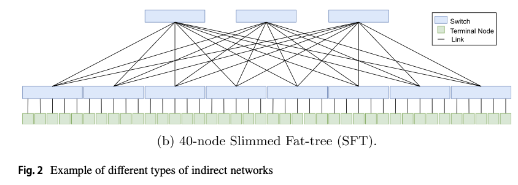

---

# HSDP - Hybrid sharding

<br>

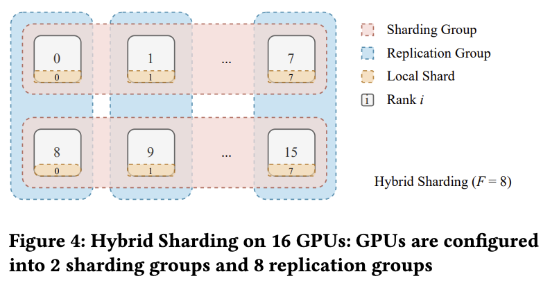

---

# Resharding to a smaller world size

In case there is enough memory post-forward resharding can be done to a smaller
world size:

- less backward all-gather comms
- higher memory consumption

<br>


---

# CPU offloading

Master weights, grads and optmizer states can be offloaded to CPU and only
  loaded to GPU before unsharding

- less memory consumption
- some overhead on CPU-GPU transfers and CPU optimizer step

<br>

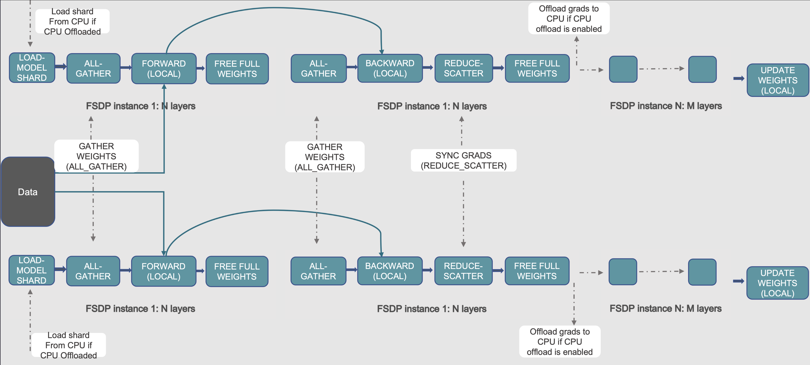

---

# FSDP implementations - FSDP1

FlatParameter, complex, bloated, buggy

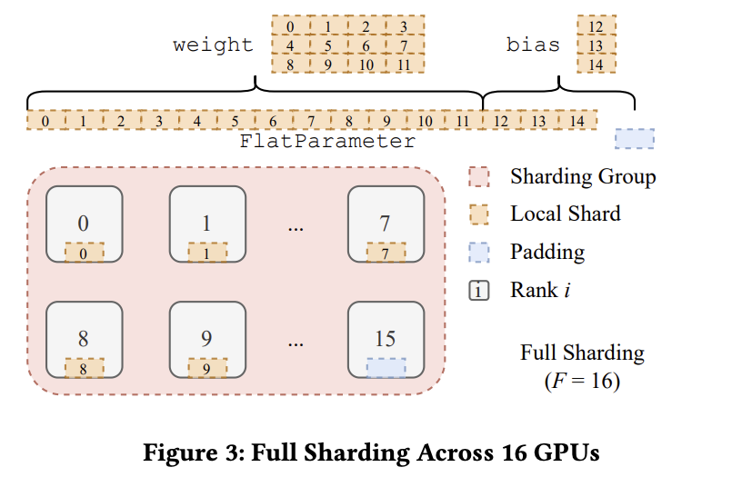

---

# FSDP implementations

## FSDP2

Per parameter sharding, clean, performant

## YaFSDP

FSDP2 rewrite with flat sharding (and so less overhead)

---

# Recap

FSDP is a data parallelism strategy with parameter sharding which:

- reduces memory consumption
- (ideally) has no performance overhead
- is used in (almost) every large-scale distributed training recipe

---
layout: statement
---

# We are hiring!

## DM `@lovanto` on Telegram for details
